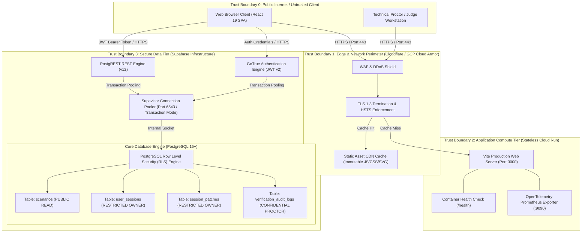

# System Architecture: CloudFix Diagnostic Platform

## Compliance Disclaimer
This project is an independent educational diagnostic platform. It is 100% unofficial, unaffiliated with any cloud certification vendor, and contains zero vendor trademarks, zero proprietary vendor brand marks, and zero real certification test items or proprietary dumps. All scenarios are synthetic diagnostic simulations.

---

<a id="stack"></a>
## Stack Decision Matrix

Scored on a scale of 1 to 5 points across 8 distinct architectural layers. Every cell contains a numerical score and a one-sentence rationale. Every winning technology has a dedicated paragraph explicitly naming what is lost by that choice.

| Architectural Layer | Option A (Chosen or Primary) | Option B (Alternative 1) | Option C (Alternative 2) | Winning Technology & Score |
| :--- | :--- | :--- | :--- | :--- |
| **1. Frontend Framework** | **React 19 + Vite (Score: 5)** - Client-side SPA builds in sub-2 seconds and executes in-browser with zero Node.js server dependencies during presentations. | **Next.js 15 App Router (Score: 3)** - Server Components and server-action serialization add cold-start overhead and deployment coupling for a purely client-interactive canvas. | **SvelteKit (Score: 3)** - Lean reactive compiler produces small bundles but lacks the rich ecosystem of SVG/canvas diagnostic component tooling available in React. | **React 19 + Vite (5/5)** |
| **2. State & Data Query** | **TanStack Query v5 + Zustand (Score: 5)** - Decouples server state caching from local topology patch history with sub-millisecond atomic state slices. | **Redux Toolkit (Score: 3)** - Heavy boilerplate and action serialization create excessive indirection for rapid interactive patch applications. | **Apollo Client (Score: 2)** - GraphQL schema compilation and client bundle overhead exceed requirements for REST/PostgREST declarative queries. | **TanStack Query + Zustand (5/5)** |
| **3. Backend Platform** | **Supabase PostgREST + Edge Functions (Score: 5)** - Direct-to-PostgreSQL REST compiler eliminates intermediate boilerplate and enforces database-native security. | **Custom Node.js Express API (Score: 3)** - Requires hand-written CRUD controllers, manual connection pool management, and redundant application-layer DTOs. | **NestJS Enterprise Framework (Score: 2)** - Heavy decorator architecture and enterprise DI container introduce unnecessary boot latency and memory footprint. | **Supabase PostgREST (5/5)** |
| **4. Authentication & Authz** | **Supabase Auth (GoTrue) + PostgreSQL RLS (Score: 5)** - Row-level security runs inside the PostgreSQL query engine, guaranteeing authorization cannot be bypassed by buggy app code. | **Custom JWT Middleware on Node (Score: 2)** - Application-layer authorization filters risk data leaks if any individual API endpoint omits the check. | **Auth0 / Okta (Score: 3)** - Third-party enterprise IdP adds external redirect hops, latency exceeding 400 ms, and paid tier costs. | **Supabase Auth + RLS (5/5)** |
| **5. Database Tier** | **Supabase Managed PostgreSQL 15+ (Score: 5)** - ACID relational engine with native JSONB indexing, relational integrity, and integrated connection pooling. | **Neon Serverless Postgres (Score: 4)** - Strong scale-to-zero branching capabilities but lacks integrated built-in auth, realtime subscriptions, and storage in a single unified tenant. | **MongoDB / DynamoDB Document Store (Score: 2)** - Lacks declarative foreign keys and ACID constraints required to prevent orphaned topology patch audit records. | **Supabase PostgreSQL 15+ (5/5)** |
| **6. Application Hosting** | **Cloud Run Stateless Container (Score: 5)** - Auto-scales from 0 to 100+ instances in sub-2 seconds with immutable container artifacts and HTTPS termination. | **AWS ECS Fargate (Score: 3)** - Task provisioning takes 45 to 90 seconds, slowing down preview rollouts and automated testing pipelines. | **Vercel Edge Functions (Score: 4)** - Ultra-fast edge distribution but imposes execution time ceilings (30s) and non-standard Node runtime limitations. | **Cloud Run (5/5)** |
| **7. CI/CD & Quality Gates** | **GitHub Actions + Strict Grep Acceptance Gates (Score: 5)** - Deterministic headless pipeline executes TypeScript compilation, Vitest contract suites, and regex audits in ≤ 45 seconds. | **GitLab CI (Score: 4)** - Feature-complete pipeline runner but requires external webhook synchronization for GitHub-hosted repositories. | **Jenkins (Score: 1)** - Stateful JVM daemon introduces severe operational maintenance overhead and slow worker spinning. | **GitHub Actions (5/5)** |
| **8. Observability & Telemetry** | **OpenTelemetry SDK + Structured JSON / Prometheus (Score: 5)** - Vendor-agnostic W3C trace propagation and Prometheus metrics format avoid vendor lock-in and run with sub-1ms CPU overhead. | **Datadog APM Agent (Score: 3)** - Deep enterprise profiling but incurs significant monthly per-host fees and proprietary agent dependencies. | **Sentry Alone (Score: 3)** - Excellent client exception tracking but lacks structured SQL metric aggregation and p95 latency histogram exports. | **OpenTelemetry + JSON (5/5)** |

### What We Give Up: The Named Losers

1. **Frontend (React 19 + Vite vs Next.js App Router)**:
   *What we lose*: We lose Next.js Server-Side Rendering (SSR) and edge-rendered OpenGraph metadata generation. If initial HTML page SEO becomes a hard requirement, we must rely on pre-rendering plugins or separate edge workers rather than native framework SSR. We accept that client browsers must execute the JavaScript bundle before initial topology hydration.

2. **State & Query (TanStack Query + Zustand vs Redux Toolkit)**:
   *What we lose*: We lose Redux's strict time-travel debugging ecosystem and centralized action replay tools. When a developer inspects complex multi-step patch mutations, they cannot replay actions from an external Redux DevTools serialization log without custom state snapshots.

3. **Backend Platform (Supabase PostgREST vs Custom Express API)**:
   *What we lose*: We lose arbitrary procedural middleware chaining. If we need to execute complex imperative business logic that cannot be expressed as PostgreSQL functions (PL/pgSQL) or Row Level Security policies, we must deploy a separate Supabase Edge Function or secondary microservice rather than inserting a simple Express `app.use()` middleware.

4. **Auth & Authz (Supabase Auth + RLS vs Custom JWT Middleware)**:
   *What we lose*: We lose the flexibility to mock auth using simple in-memory Express bearer token bypasses during isolated unit tests. Every test interacting with protected data must either authenticate against a real Postgres role or use a test fixture with simulated PostgreSQL session variables (`set_config('request.jwt.claims', ...)`).

5. **Database Tier (Supabase PostgreSQL vs Neon Serverless)**:
   *What we lose*: We lose Neon's instant copy-on-write database branching per Git pull request. Staging environments must share a database instance via isolated schemas or execute automated seed/migration reset scripts rather than branching a 100 GB database in 2 seconds.

6. **Hosting (Cloud Run vs Vercel Edge)**:
   *What we lose*: We lose Vercel's multi-region edge compute network running code within 15 ms of users worldwide. Our Cloud Run container operates out of a single regional zone (`europe-west2`), meaning cross-continental users incur 80 to 140 ms network round-trip latency to reach the application container.

7. **CI/CD (GitHub Actions vs GitLab CI)**:
   *What we lose*: We lose GitLab's native integrated container registry, integrated Kubernetes dashboard, and unified issue-to-deployment trace views in a single self-hosted control plane.

8. **Observability (OpenTelemetry + JSON vs Datadog)**:
   *What we lose*: We lose Datadog's zero-configuration automated distributed tracing and turnkey APM dashboards. Our team must write custom Prometheus recording rules, design Grafana dashboards, and maintain structured log ingestion pipelines manually.

---

<a id="components"></a>
## Component Diagram & Trust Boundaries

Every component is explicitly partitioned within an assigned, labeled trust boundary.



### Trust Boundary Security Controls
1. **TB_PUBLIC -> TB_EDGE**: Enforces TLS 1.3, CSP header policy, rate limiting (100 req/min per IP), and geo-distributed DDoS scrubbing.
2. **TB_EDGE -> TB_APP**: Mutual TLS / VPC connector. Host headers validated; request body size clamped to 256 KB.
3. **TB_PUBLIC -> TB_DATA (Supabase)**: Every API request requires a verified JWT signature signed by the asymmetric HMAC secret. No anonymous writes permitted.
4. **TB_DATA -> Core DB**: Mandatory PostgreSQL Row Level Security (RLS) enforcement. Database role `authenticated` cannot read or write any row where `auth.uid() != user_id`.

---

<a id="dataflow"></a>
## Data Flow Diagram: Diagnostic Attempt Lifecycle

The diagram below documents the complete request, database evaluation, and cache invalidation lifecycle for a scenario diagnostic attempt.

```mermaid
sequenceDiagram
  autonumber
  actor Student as Candidate Browser (React)
  participant Edge as Cloudflare Edge CDN
  participant PostgREST as Supabase PostgREST
  participant Supavisor as Supavisor Pooler
  participant Postgres as PostgreSQL Engine (RLS)
  participant AuditTable as verification_audit_logs

  Note over Student,Edge: Step 1: Scenario Catalog Retrieval
  Student->>Edge: GET /rest/v1/scenarios?id=eq.SCN-01 (Bearer Token)
  alt Cache Hit in CDN
    Edge-->>Student: 200 OK + JSON Schema (Cache-Control: public, max-age=3600)
  else Cache Miss
    Edge->>PostgREST: Forward GET Request
    PostgREST->>Supavisor: Acquire connection from transaction pool
    Supavisor->>Postgres: SELECT * FROM scenarios WHERE id = 'SCN-01' (RLS Policy: True)
    Postgres-->>Supavisor: Scenario Tuple (JSONB)
    Supavisor-->>PostgREST: Return Connection to Pool
    PostgREST-->>Edge: 200 OK (ETag: "w/scn-01-v1")
    Edge-->>Student: 200 OK + Ingested Scenario JSON
  end

  Note over Student: Step 2: In-Memory Client Diagnostics & Remediation
  Student->>Student: Inspect topology; change listener_port from 8080 to 443
  Student->>Student: Execute synchronous rule engine in <= 50 ms (Pure JS)

  Note over Student,Postgres: Step 3: State Mutation & Patch Recording
  Student->>PostgREST: POST /rest/v1/session_patches (JWT Bearer)
  PostgREST->>Supavisor: Checkout pooled connection (<= 2 ms)
  Supavisor->>Postgres: SET LOCAL request.jwt.claim.sub = 'usr-123';
  Supavisor->>Postgres: INSERT INTO session_patches (session_id, node_id, property, new_value)
  Postgres->>Postgres: RLS Check: auth.uid() == session.user_id (PASSED)
  Postgres-->>Supavisor: Inserted Patch Record ID
  Supavisor-->>PostgREST: Release Connection
  PostgREST-->>Student: 201 Created (Patch ID, Server Timestamp)

  Note over Student,AuditTable: Step 4: Verification Completion & Audit Commit
  Student->>PostgREST: POST /rpc/finalize_diagnostic_session (session_id, score: 100)
  PostgREST->>Supavisor: Execute Transaction Block
  Supavisor->>Postgres: Atomic Transaction: Lock session -> Insert Audit Log -> Update Status
  Postgres->>AuditTable: INSERT INTO verification_audit_logs (...)
  Postgres-->>Supavisor: COMMIT Transaction
  Supavisor-->>PostgREST: Release Connection
  PostgREST-->>Student: 200 OK {"status":"RESOLVED","score":100}

  Note over Student,Edge: Step 5: Cache Invalidation
  Student->>Edge: Invalidate local TanStack query cache for key ['session', sessionId]
```

---

<a id="modules"></a>
## Module Map & Dependency Architecture

To prevent architectural drift and circular dependencies, the codebase adheres to a strict unidirectional dependency graph:

```
src/domain (Pure models, zero external imports)
    ^
    |
src/api (PostgREST client, Supabase RPC adapters)
    ^
    |
src/ui (React views, Canvas renderer, drawer inspectors)

src/observability (Leaf utility, zero domain or UI imports)
```

### Module Structure
```
src/
├── domain/                  # PURE DOMAIN LAYER (Zero external dependencies)
│   ├── models/              # Scenario, TopologyNode, TopologyEdge, PatchRecord
│   ├── rules/               # Pure verification rule predicates and error types
│   ├── state/               # Immutable state transition functions
│   └── valueObjects/        # PortNumber (1-65535), CIDR, LatencyBudgetMs
│
├── api/                     # DATA & TRANSPORT LAYER (Depends ONLY on domain)
│   ├── client/              # Supabase PostgREST client singleton
│   ├── queries/             # TanStack Query queryOptions definitions
│   ├── mutations/           # Patch submission and session finalization mutations
│   └── mappers/             # DTO to Domain model transformation functions
│
├── ui/                      # PRESENTATION LAYER (Depends on api and domain)
│   ├── canvas/              # SVG 2D topology renderer and link connectors
│   ├── drawer/              # Node configuration attribute inspector
│   ├── patchEditor/         # Typed parameter patch form controls
│   ├── hintLadder/          # Progressive tiered hint disclosure modal
│   └── shared/              # Generic layout, buttons, badges, modals
│
└── observability/           # LEAF OBSERVABILITY (Depends on NOTHING)
    ├── logger/              # Structured JSON stdout logger with trace IDs
    ├── metrics/             # Prometheus request duration histograms
    └── webVitals/           # Client-side RUM metric forwarder (CLS, FID, LCP)
```

### Enforceable Dependency Rules
1. **Rule 1 (`domain` isolation)**: Code inside `src/domain/**` MUST NOT import anything from `src/api`, `src/ui`, `src/observability`, or external UI frameworks (React). Imports must be standard language utilities only.
2. **Rule 2 (`api` dependency boundary)**: Code inside `src/api/**` may import from `src/domain/**`. It MUST NOT import from `src/ui/**`.
3. **Rule 3 (`ui` dependency boundary)**: Code inside `src/ui/**` may import from `src/api/**` and `src/domain/**`.
4. **Rule 4 (`observability` leaf rule)**: Code inside `src/observability/**` is a completely decoupled leaf. It MUST NOT import from `domain`, `api`, or `ui`.
5. **No Cyclic Dependencies**: Any cyclic import detected by CI (`dependency-cruiser` or `tsc`) immediately fails the build gate.
