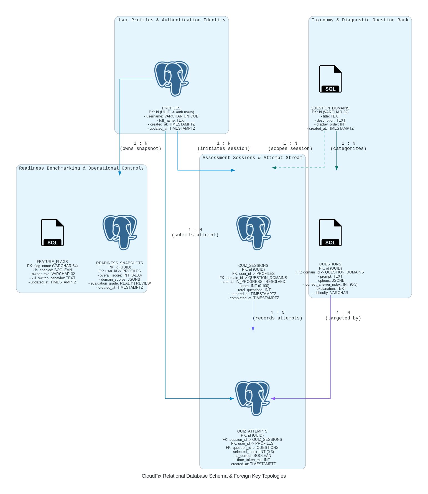
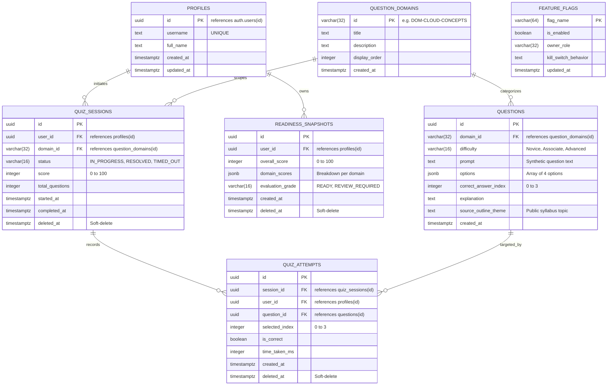

# Data Model & Schema Specification: Cloud Readiness Engine

## 1. Compliance Disclaimer
This database schema is an independent educational diagnostic specification. It contains zero vendor trademarks, zero proprietary vendor brand marks, and zero real certification test items or proprietary dumps. All questions, taxonomy domains, and scoring models are synthetic first-principles artifacts.

---

## 2. Entity-Relationship Diagram (ERD)

*Python Database Architecture as Code: [`docs/diagrams/database_erd.py`](diagrams/database_erd.py)*

---

## 3. Ownership & Audit Standard

### Ownership Columns
- Every candidate-owned record (`quiz_sessions`, `quiz_attempts`, `readiness_snapshots`) mandates a foreign key `user_id UUID NOT NULL REFERENCES auth.users(id) ON DELETE CASCADE`.
- This column is immutable and bound unconditionally to the active PostgreSQL session claim `auth.uid()`.

### Audit Columns
- `created_at TIMESTAMPTZ NOT NULL DEFAULT clock_timestamp()`
- `updated_at TIMESTAMPTZ NOT NULL DEFAULT clock_timestamp()`
- An automated trigger `set_updated_at_timestamp()` updates `updated_at` on every `UPDATE` statement.

---

## 4. Soft-Delete & 30-Day Retention Policy

### Soft-Delete Standard
All tables categorized as **RESTRICTED** (`quiz_sessions`, `quiz_attempts`, `readiness_snapshots`) include a `deleted_at TIMESTAMPTZ NULL` column.
- Application queries through PostgREST evaluate `deleted_at IS NULL` via default views or RLS policies.
- User deletion requests set `deleted_at = clock_timestamp()` without destroying the row immediately, preserving proctor auditability for 30 days.

### Hard-Purge Job
A scheduled PostgreSQL function `purge_expired_records(retention_days INT)` runs nightly at 03:00 UTC:
- Permanently deletes rows where `deleted_at < now() - (retention_days || ' days')::interval`.
- Cascades from `quiz_sessions` down to `quiz_attempts`.

---

## 5. Index-to-Query & Endpoint Mapping Table

Every index in the database is strictly mapped to an operational API endpoint and documented SQL query.

| Index Name | Table | Indexed Columns | Endpoint Served | Specific Query Pattern | Scan Type Verified |
| :--- | :--- | :--- | :--- | :--- | :--- |
| **`idx_quiz_sessions_user_history`** | `quiz_sessions` | `(user_id, started_at DESC)` | `GET /rest/v1/quiz_sessions` | `SELECT * FROM quiz_sessions WHERE user_id = $1 AND deleted_at IS NULL ORDER BY started_at DESC LIMIT 20` | **Index Scan** (no filesort) |
| **`idx_quiz_attempts_user_domain`** | `quiz_attempts` | `(user_id, created_at DESC)` | `POST /rpc/calculate_readiness` | `SELECT domain_id, AVG(is_correct::int) FROM quiz_attempts a JOIN questions q ON a.question_id = q.id WHERE a.user_id = $1 AND a.deleted_at IS NULL GROUP BY domain_id` | **Bitmap Index Scan** |
| **`idx_quiz_attempts_session_id`** | `quiz_attempts` | `(session_id)` | `GET /rest/v1/quiz_sessions?select=*,quiz_attempts(*)` | `SELECT * FROM quiz_attempts WHERE session_id = $1 AND deleted_at IS NULL` | **Index Scan** |
| **`idx_questions_domain_difficulty`**| `questions` | `(domain_id, difficulty)` | `GET /rest/v1/questions` | `SELECT * FROM questions WHERE domain_id = $1 AND difficulty = $2 ORDER BY random() LIMIT 10` | **Bitmap Index Scan** |
| **`idx_readiness_user_created`** | `readiness_snapshots` | `(user_id, created_at DESC)` | `GET /rest/v1/readiness_snapshots` | `SELECT * FROM readiness_snapshots WHERE user_id = $1 AND deleted_at IS NULL ORDER BY created_at DESC LIMIT 1` | **Index Scan** |
| **`idx_quiz_sessions_deleted_at`** | `quiz_sessions` | `(deleted_at) WHERE deleted_at IS NOT NULL` | Nightly Hard-Purge Cron | `DELETE FROM quiz_sessions WHERE deleted_at < now() - interval '30 days'` | **Index Scan** (partial index) |
