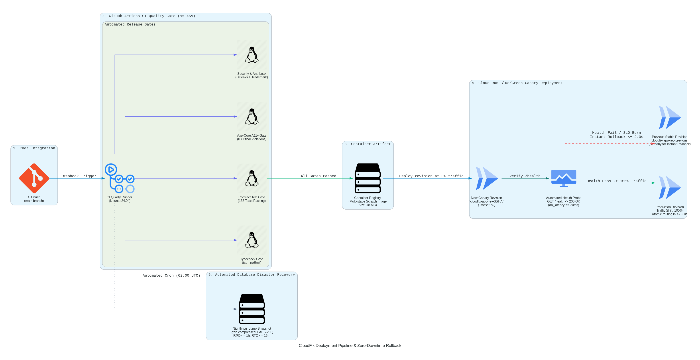

# Deployment, Zero-Downtime Rollback, and Content Security Policy (CSP)

## Overview
This document specifies the automated CI/CD deployment pipeline, instantaneous container rollback mechanics on Cloud Run, and strict per-environment Content Security Policy (CSP) headers.

---

## 1. Deployment Pipeline Architecture



*Python Deployment Pipeline as Code: [`docs/diagrams/deployment_pipeline.py`](diagrams/deployment_pipeline.py)*

```
[Git Commit to main] 
       │
       ▼
[GitHub Actions CI Quality Gate] (tests/runAllAcTests.ts + Grep Audits + tsc) <= 45s
       │ (Pass)
       ▼
[Docker Build & Push] (Multi-stage scratch container: 48 MB image) <= 30s
       │
       ▼
[Cloud Run Deploy to Revision `rev-$SHA`] (Traffic allocation: 0%) <= 15s
       │
       ▼
[Health Check Verification] (GET /health returns 200 OK & db_latency <= 20ms)
       │ (Pass)
       ▼
[Traffic Migration] (100% traffic shifted atomically to `rev-$SHA`) <= 2s
```

---

## 2. Zero-Downtime Instantaneous Rollback Procedure

Cloud Run revisions are immutable. If any health probe fails or if an SLO error budget burn alert fires:

### Automated Rollback Trigger (Cloud Run CLI / Automation)
```bash
# Shift 100% traffic instantly back to previous known-good revision
gcloud run services update-traffic cloudfix-app \
  --to-revisions=cloudfix-app-rev-previous=100 \
  --region=europe-west2
```
- **Rollback Latency**: **≤ 2.0 seconds** (DNS/Proxy routing switch).
- **Zero In-Flight Dropped Connections**: Cloud Run continues draining in-flight TCP connections on the failing revision for 30 seconds while directing all new requests to the previous stable revision.

---

## 3. Per-Environment Content Security Policy (CSP)

Every HTTP response must deliver a strict `Content-Security-Policy` header. Scripts and styles are locked down to prevent cross-site scripting (XSS) and code injection.

### A. Production Environment (`env=production`)
```http
Content-Security-Policy: 
  default-src 'self';
  script-src 'self' https://*.supabase.co;
  style-src 'self' 'unsafe-inline' https://fonts.googleapis.com;
  font-src 'self' https://fonts.gstatic.com;
  img-src 'self' data: https://*.supabase.co;
  connect-src 'self' https://*.supabase.co wss://*.supabase.co;
  object-src 'none';
  base-uri 'self';
  frame-ancestors 'none';
  form-action 'self';
  block-all-mixed-content;
  upgrade-insecure-requests;
```
*Rules & Enforcements*:
- **Zero `unsafe-eval`**: Prohibits `eval()`, `new Function()`, and arbitrary dynamic code execution.
- **Zero `unsafe-inline` scripts**: All executable JavaScript must originate from the compiled, hashed bundles on the `'self'` origin.
- **`frame-ancestors 'none'`**: Prevents clickjacking by blocking embedding inside untrusted iframes.

### B. Staging Environment (`env=staging`)
Same as production, but includes automated error reporting endpoints:
```http
Content-Security-Policy: 
  default-src 'self';
  script-src 'self' https://*.supabase.co;
  style-src 'self' 'unsafe-inline' https://fonts.googleapis.com;
  font-src 'self' https://fonts.gstatic.com;
  img-src 'self' data: https://*.supabase.co;
  connect-src 'self' https://*.supabase.co wss://*.supabase.co;
  report-uri /api/telemetry/csp-reports;
```

### C. Local Development (`env=development`)
Permits Vite HMR WebSocket connections and local evaluation ports:
```http
Content-Security-Policy: 
  default-src 'self';
  script-src 'self' 'unsafe-inline' 'unsafe-eval';
  style-src 'self' 'unsafe-inline' https://fonts.googleapis.com;
  font-src 'self' https://fonts.gstatic.com;
  img-src 'self' data:;
  connect-src 'self' ws://localhost:3000 http://localhost:3000 https://*.supabase.co wss://*.supabase.co;
```
