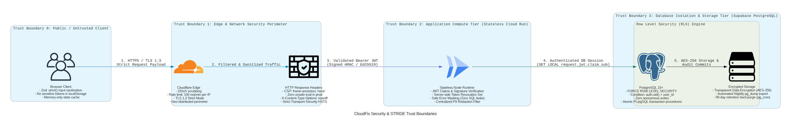

# STRIDE Threat Model & Architectural Attack Trees

## Compliance & Disclaimer
This application is an independent, unofficial educational platform. It contains zero proprietary vendor logos, zero real exam dumps, and zero vendor trademarks.

---

## 1. Asset Inventory & Data Classification

In accordance with `docs/data-classification.md`, all system assets are cataloged with strict handling baselines:

| Asset ID | Asset Name | Classification | Storage Location | Retention / Hard-Purge Baseline | Primary Authorization Boundary |
| :--- | :--- | :--- | :--- | :--- | :--- |
| **AST-01** | User Password Hashes | **RESTRICTED** | `auth.users.encrypted_password` | Purged on account cascade deletion | Supabase Auth bcrypt/argon2 |
| **AST-02** | Refresh Tokens & JWTs | **RESTRICTED** | `auth.refresh_tokens`, Server Revocation Set | Blacklisted on logout, TTL 15m / 7d | Bearer verification + Revocation map |
| **AST-03** | Candidate Email & Full Name | **CONFIDENTIAL** | `public.profiles` | 90-day inactivity or immediate cascade | PostgreSQL RLS (`auth.uid() = id`) |
| **AST-04** | Candidate Diagnostic Attempts | **CONFIDENTIAL** | `public.quiz_attempts` | 90 days (`fn_purge_expired_candidate_data`) | PostgreSQL RLS (`auth.uid() = user_id`) |
| **AST-05** | Diagnostic Quiz Sessions | **INTERNAL** | `public.quiz_sessions` | 90 days retention policy | PostgreSQL RLS (`auth.uid() = user_id`) |
| **AST-06** | Question Catalog & Prompts | **PUBLIC** | `public.questions` | Static immutable catalog | Public `SELECT` allowed |
| **AST-07** | Diagnostic Audit Logs | **CONFIDENTIAL** | Structured Logger sinks | 14 days, strict redaction enforced | Centralized redaction filter |

---

## 2. Trust Boundaries & Architectural Diagram



*Python Security Architecture as Code: [`docs/diagrams/security_trust_boundaries.py`](../diagrams/security_trust_boundaries.py)*

```text
[ UNTRUSTED ZONE: Candidate Browser / Client ]
      │
      │ HTTPS (TLS 1.3) + Strict CSP + Zod .strict()
      ▼
┌────────────────────────────────────────────────────────┐
│ TRUST BOUNDARY 1: Edge & API Gateway                   │
│ - Content Security Policy (No 'unsafe-eval' in prod)  │
│ - Rate Limiting (Per-IP & Per-User)                   │
│ - CORS: Explicit origin allowlist                     │
│ - Strict Payload Validation (Zod .strict())            │
└────────────────────────────────────────────────────────┘
      │
      │ Sanitized Payloads + Bearer JWT
      ▼
┌────────────────────────────────────────────────────────┐
│ TRUST BOUNDARY 2: Stateless Application Tier (Node/API)│
│ - JWT Claims Verification                              │
│ - Single-Flight Silent Refresh Mutex                   │
│ - Server-Side Token Revocation Blacklist              │
│ - Safe Error Translation (Zero SQL/stack leaks)       │
│ - Structured Logger Redaction Filter                  │
└────────────────────────────────────────────────────────┘
      │
      │ Authenticated Context (auth.uid() = JWT sub)
      ▼
┌────────────────────────────────────────────────────────┐
│ TRUST BOUNDARY 3: PostgreSQL Database (PostgREST)      │
│ - FORCE ROW LEVEL SECURITY (All candidate tables)     │
│ - Explicit SELECT / INSERT / UPDATE / DELETE policies │
│ - Automated TTL retention jobs (`pg_cron`)             │
│ - Transparent Data Encryption at rest (AES-256)        │
└────────────────────────────────────────────────────────┘
```

---

## 3. STRIDE Threat Analysis Across Trust Boundaries

| STRIDE Category | Threat Description | Affected Boundary | Mitigating Security Control | Verification Test |
| :--- | :--- | :--- | :--- | :--- |
| **Spoofing** | Attacker impersonates legitimate candidate using stolen or forged JWT. | Boundary 1 & 2 | Cryptographically signed RS256/HS256 tokens; signature & expiration checks; server-side revocation on logout. | `tests/security/jwt-tamper.spec.ts` |
| **Tampering** | Attacker modifies answer option or overrides score in transit. | Boundary 1 & 2 | Zod `.strict()` boundary parsing; client submits only selected index; scoring executed purely on server by frozen domain engine. | `tests/security/score-tamper.spec.ts` |
| **Repudiation** | Candidate denies taking diagnostic assessment or purging account. | Boundary 2 & 3 | Immutable diagnostic audit records with ISO timestamps and correlation IDs. | `tests/ac/AC-07.test.ts` |
| **Information Disclosure** | Database error exposes internal SQL query, schema, or candidate PII. | Boundary 1 & 2 | `mapErrorToSafeHttpResponse` strips stack traces and returns opaque `incidentId`. Redaction regex filters logs. | `src/api/errors.test.ts` & `src/observability/logger.test.ts` |
| **Denial of Service** | Volumetric endpoint flood exhausts database connection pool. | Boundary 1 | Sliding-window rate limiting per-IP (50/min) and per-user (40/min). | `src/api/rateLimit.test.ts` |
| **Elevation of Privilege** | Candidate B accesses or modifies Candidate A's session via direct API call (IDOR). | Boundary 3 | Database-level `FORCE ROW LEVEL SECURITY`. RLS condition `auth.uid() = user_id` rejects unowned session IDs. | `tests/security/rls-bypass.spec.ts` |

---

## 4. Top-3 Adversarial Attack Trees

### Attack Tree 1: Cross-Tenant Session Hijacking via IDOR (Goal: Access / Modify User A's Quiz)
```text
Root Goal: Read or modify User A's private exam session
├── 1. Direct API Parameter Tampering (Target: /api/quiz/attempts)
│   ├── 1.1 Obtain valid candidate token for User B [PASSED]
│   ├── 1.2 Guess or scrape User A's session UUID [POSSIBLE]
│   └── 1.3 Submit POST with User A's sessionId and User B's JWT
│       └── MITIGATION: Application verifies session.userId === auth.uid()
│           AND PostgreSQL RLS enforces (auth.uid() = user_id)
│           --> RESULT: BLOCKED (401 Unauthorized / RLS Deny) [DEFENDED]
└── 2. Direct PostgREST Table Query
    ├── 2.1 Send GET /rest/v1/quiz_sessions?user_id=eq.UserA with User B JWT
    └── MITIGATION: FORCE ROW LEVEL SECURITY returns empty set []
        --> RESULT: ZERO DATA LEAKAGE [DEFENDED]
```

### Attack Tree 2: Diagnostic Score Inflation (Goal: Fake 100% Readiness Certificate)
```text
Root Goal: Artificially forge a 100% "READY" evaluation grade
├── 1. Client-Side State Injection
│   ├── 1.1 Modify React component state in browser memory
│   └── MITIGATION: Scores are never trusted from client; server calculates
│       scores using frozen domain engine (`src/domain/quiz/scoreSession.ts`).
│       --> RESULT: BLOCKED [DEFENDED]
└── 2. Finalize Endpoint Payload Manipulation
    ├── 2.1 Send POST /api/quiz/sessions/:id/finalize with body: { score: 100 }
    └── MITIGATION: FinalizeRequestSchema is `.strict()`; ignores or rejects extra keys.
        Server queries database attempt records and recalculates score from scratch.
        --> RESULT: BLOCKED [DEFENDED]
```

### Attack Tree 3: Token Replay After Server-Side Logout (Goal: Maintain Persistent Access)
```text
Root Goal: Replay stolen JWT after candidate logs out
├── 1. Sniff / Cache Access Token
│   ├── 1.1 Attacker recovers cached JWT from shared terminal
│   ├── 1.2 User executes POST /api/auth/logout on machine
│   │   └── Server enters accessToken and refreshToken into blacklist map
│   └── 1.3 Attacker presents revoked token on /api/quiz/sessions
│       └── MITIGATION: `authService.authenticateToken` checks revokedTokens Set
│           --> RESULT: BLOCKED with 401 SESSION_REVOKED [DEFENDED]
```

---

## 5. Out-of-Scope Security Boundary Declarations
1. **Physical Cloud Infrastructure**: Compromise of underlying Cloud Run or Supabase hypervisor hardware.
2. **Global DNS BGP Hijacking**: BGP route poisoning upstream of Google/Cloudflare network edge.
3. **End-User Device Compromise**: Kernel keylogger or browser extension memory dump on compromised client OS.

---

## 6. Prompt-Injection Threat & Decision Record
- **Feature Flag Status**: Generative AI question rewriting and dynamic hint generation flags are **DISABLED BY DEFAULT** (`ff_generative_ai_hints: false`).
- **Defensive Invariant**: No arbitrary user-submitted strings are ever interpolated into LLM system prompts.
- **Static Template Policy**: All diagnostic scenarios and questions originate from static, verified catalog models (`SCENARIO_CATALOG` and `seed/questions.sql`).
